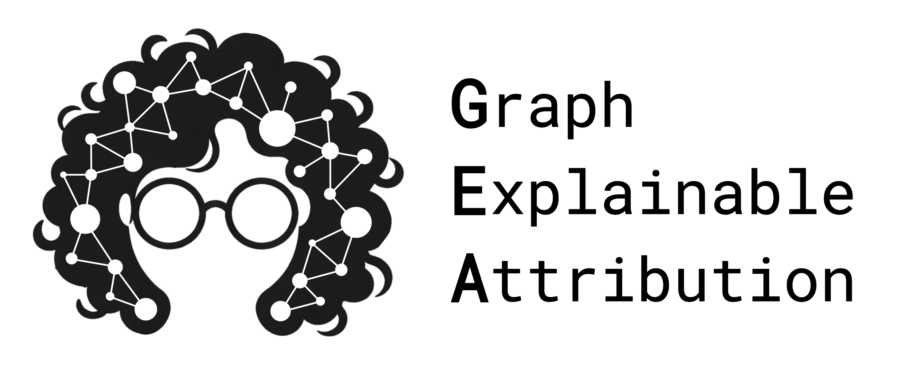
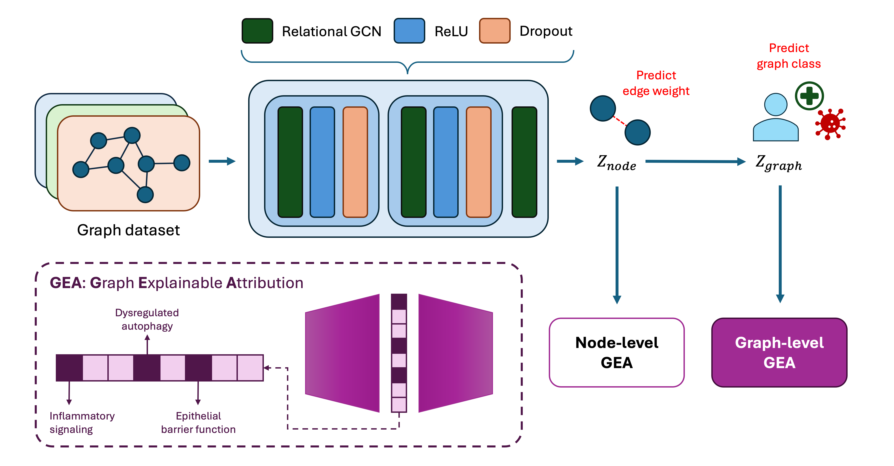

<!-- <picture>
  <source media="(prefers-color-scheme: dark)" srcset="https://raw.githubusercontent.com/Multiomics-Analytics-Group/gea/HEAD/docs/images/gea_night_no_bg.png">
  <source media="(prefers-color-scheme: light)" srcset="https://raw.githubusercontent.com/Multiomics-Analytics-Group/gea/HEAD/docs/images/gea_day_no_bg.png">
  
</picture> -->


<p align="center"><em>GEA: Decomposing GNN embeddings with Graph Explainable Attribution</em></p>

GEA is a framework for decomposing embeddings generated by a trained Graph Neural Network (GNN) model to give relevant biological insights at the node, edge and graph level. Sparse Autoencoders are employed in the framework, in which its sparse features activation can serve as actionable insights on how the internal mechanisms of the model represents information. 

An overview of the workflow can be found below:




## Table of Contents :bookmark_tabs:

- [Table of Contents :bookmark\_tabs:](#table-of-contents-bookmark_tabs)
- [:gear: Installation](#gear-installation)
- [Features](#features)
- [:rocket: Usage](#rocket-usage)
  - [:brain: General workflow](#brain-general-workflow)
  - [:microscope: GEA applied to molecules](#microscope-gea-applied-to-molecules)
- [Documentation](#documentation)
- [License](#license)

## :gear: Installation 

The project environment can be recreated using the provided Conda environment file.

Make sure [Conda](https://docs.conda.io/projects/conda/en/latest/) is installed, then run:

```bash
conda env create -f environment.yml
```

This will create the environment with the required dependencies.

Activate the environment using:

```bash
conda activate gea
```

You can check that the environment is correctly installed with:

```bash
conda env list
```

The `gea` environment should be listed as the active environment.

If the `environment.yml` file is updated, update the existing environment with:

```bash
conda env update -f environment.yml --prune
```

The `--prune` option removes packages that are no longer specified in the environment file.

____

> [!TIP]
> It is recommended to install GEA inside a virtual environment to manage depenendencies and avoid conflicts with existing packages. You can use the virtual environment manager of your choice, such as `poetry`, `conda`, or `pipenv`.

You can install the package for development by cloning this repository and running the following command:

> [!WARNING]
> We assume you are in the root directory of the cloned repository when running this command. Otherwise, you need to specify the path to the `gea` directory.

```bash
pip install -e .
```

## Features

## :rocket: Usage

### :brain: General workflow

GEA's workflow consists of four stages:

1. **Train a Sparse Autoencoder (SAE)** on a training set of embedding vectors (e.g., node-, edge-, or graph-level embeddings).
2. **Annotate the learned SAE features** using a validation set and the corresponding concept annotations.
3. **Evaluate the learned features** on an independent test set.
4. **Interpret your GNN** using the annotated features.  

| Stage | Description | Script |
|:---:|---|---|
| 1 | SAE training | `train_sae.py` |
| 2 | Feature annotation | `gea_pipeline.py` |
| 3 | Feature evaluation | `gea_pipeline.py` |
| 4 | GNN interpretation | `sae_annotation_association.py` and `interpretation_plots.py` |

Annotations provide a way to associate SAE features with domain-specific concepts. The type of concepts used for annotation depends on the application domain (see *GEA applied to molecules* for an example based on molecular motifs).

The SAE training script requires an `.npz` file containing the following five entries:

- **`embeddings`**: A NumPy array of shape `(N, D)`, where `N` is the number of embedding vectors and `D` is the embedding dimension. Each row represents an embedding corresponding to a graph, node, or edge, depending on the embedding level.
- **`annotations`**: A NumPy object array of length `N`, where each element is a dictionary mapping concept names to their corresponding labels for that sample. These annotations describe domain-specific concepts associated with each embedding.
- **`entities`**: A NumPy array of length `N` identifying the entity associated with each embedding (e.g., a molecule identifier or SMILES string). For node- or edge-level embeddings, multiple samples may share the same entity.
- **`prediction`**: A NumPy array of length `N` containing the model prediction associated with each embedding.
- **`target`**: A NumPy array of length `N` containing the corresponding ground-truth value or label.

All entries must contain the same number of samples, and their elements must be aligned. In other words, the *i*-th element of each entry must correspond to the same sample:

`embeddings[i]`, `annotations[i]`, `entities[i]`, `prediction[i]`, and `target[i]` must all describe the same graph, node, or edge.

**Samples and entities**

A sample corresponds to an individual embedding vector, whereas an entity identifies the graph or object to which that sample belongs. Their relationship depends on the embedding level:

- **Graph-level embeddings:** Each sample represents one graph, so each entity corresponds to a single sample.
- **Node-level embeddings:** Each sample represents one node, and multiple samples can belong to the same entity (e.g., multiple atoms belonging to the same molecule).
- **Edge-level embeddings:** Each sample represents one edge, and multiple samples can belong to the same entity (e.g., multiple bonds belonging to the same molecule).

For example, when using molecular node-level embeddings, each row of `embeddings` represents an atom, while `entities` identifies the molecule to which that atom belongs. Therefore, the same entity identifier (e.g., SMILES string) can appear in multiple rows.

The **SAE training** script supports both graph-level and node-level embeddings through the `--level` argument.

For **graph-level embeddings**, samples are randomly divided into training, validation, and test sets according to the proportions specified by `--splits`.

For **node-level embeddings**, the split is performed at the entity level. All embeddings associated with the same `entity` are assigned to the same split, preventing embeddings from the same graph from being distributed across different splits.

By default, the data are divided into 80% training, 10% validation, and 10% test sets. The random seed is controlled using `--seed`.

To train an SAE, run:

```bash
python scripts/gea/train_sae.py \
    --embeddings_path node_embeddings.npz \
    --d_z 1200 \
    --epochs 50 \
    --level node
```

To see all available command-line arguments, run:

```bash
python scripts/gea/train_sae.py --help
```

The **second and third stages** of the GEA workflow, feature annotation and evaluation, can be performed using:

```bash
python scripts/gea/gea_pipeline.py \
    --embeddings_path node_embeddings.npz
```

This script requires the dataset splits generated during SAE training. The splits are saved by `train_sae.py` and are loaded from the same path by default. If a different location was used during training, it can be specified using `--splits_path`. 

Annotations can represent binary, count-based, or continuous concepts. When the dataset includes count-based or continuous annotations, these should be handled using the --is_numeric flag.

By default, the results are saved to:

```text
gea_annotation_results.pt
```

A different output location can be specified using the `--results_path` argument.

To see all available command-line arguments, run:

```bash
python scripts/gea/gea_pipeline.py --help
```

The **final stage** of GEA involves the interpretation of your GNN using the annotated features. To facilitate this step, we provide a script to extract the target and prediction values and the activations for each SAE feature for each entity.

```bash
python scripts/gea/sae_annotation_association.py \
    --embeddings_path graph_embeddings.npz \
    --splits_path splits_graph.pt \
    --checkpoint_path sae_model_graph.pt \
    --output_path sae_annotation_association.pt \
    --maxima_path feature_maxima_train_graph.pt \
    --class_names '{"0": "class_0", "1": "class_1"}'
```

The resulting association statistics and sample-level feature activations are saved to the file specified by --output_path. Class names can be defined using --class_names, as a dictionary mapping class labels to their corresponding names.

To see all available command-line arguments, run:

```bash
python scripts/gea/sae_annotation_association.py --help
```

Finally, `interpretation_plots.py` uses the results obtained using `gea_pipeline.py` and `sae_annotation_association.py` to generate plots for interpreting SAE features. 

```bash
python scripts/gea/interpretation_plots.py \
    --gea_result_path gea_annotation_results.pt \
    --sae_annotation_association_path sae_annotation_association.pt \
    --output_dir gea_results \
    --is_numeric \
    --class_names '{"0": "class_0", "1": "class_1"}'
```


### :microscope: GEA applied to molecules

GEA has been applied to embeddings obtained using a [fine-tuned version of GROVER](https://github.com/m-baralt/grover) trained to predict solubility from molecular structures.

The embedding file is a Python dictionary in which each key corresponds to a molecule represented as a SMILES string. Each value is a dictionary containing the following embeddings and metadata:

- **`atom_from_atom`**
- **`atom_from_bond`**
- **`bond_from_atom`**
- **`bond_from_bond`**
- **`graph_from_atom_from_atom`**
- **`graph_from_atom_from_bond`**
- **`prediction`**
- **`target`**

The embeddings represent different molecular entities and can subsequently be converted into the standardized `.npz` format required by the general GEA workflow.

Once the embeddings have been obtained, a molecular motif dictionary can be created by running:

```bash
python scripts/gea_molecules/create_motif_dict.py
```

By default, the motif dictionary is saved as:

```text
dict/motif_dictionary.pkl
```

This dictionary can be extended or modified to include additional molecular concepts.

Given the embedding file and the motif dictionary, molecular embeddings can be annotated and prepared for SAE training using:

```bash
python scripts/gea_molecules/motifs_annotation.py \
    --embeddings_path grover_embeddings_solubility.pt
```

This script generates the `.npz` files containing embeddings, annotations, and additional metadata required for the GEA workflow.

By default, motifs_annotation uses `atom_from_atom` embeddings for nodes and `graph_from_atom_from_atom` embeddings for graphs. These can be changed using the `--embedding_key_node` and `--embedding_key_graph` arguments.

To see all available command-line arguments, run:

```bash
python scripts/gea_molecules/motifs_annotation.py --help
```

Once the embeddings and annotations have been prepared, the SAE can be trained using the molecular-specific training script. Molecules are split using a scaffold-based splitting approach to ensure that molecules with similar structural scaffolds are not distributed across the training, validation, and test sets.

```bash
python scripts/gea_molecules/train_sae.py \
    --embeddings_path node_embeddings.npz \
    --d_z 1200 \
    --epochs 50
```

The annotation and evaluation stages can then be performed using `gea_pipeline` as described above.

## Documentation

## License

The code in this repository is licensed under the **MIT License**, allowing you to use, modify, and distribute it freely as long as you include the original copyright and license notice.